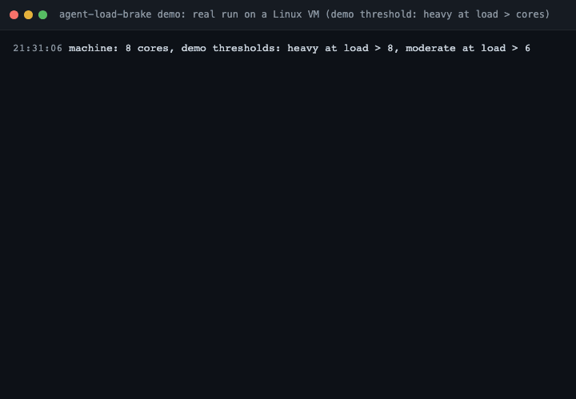
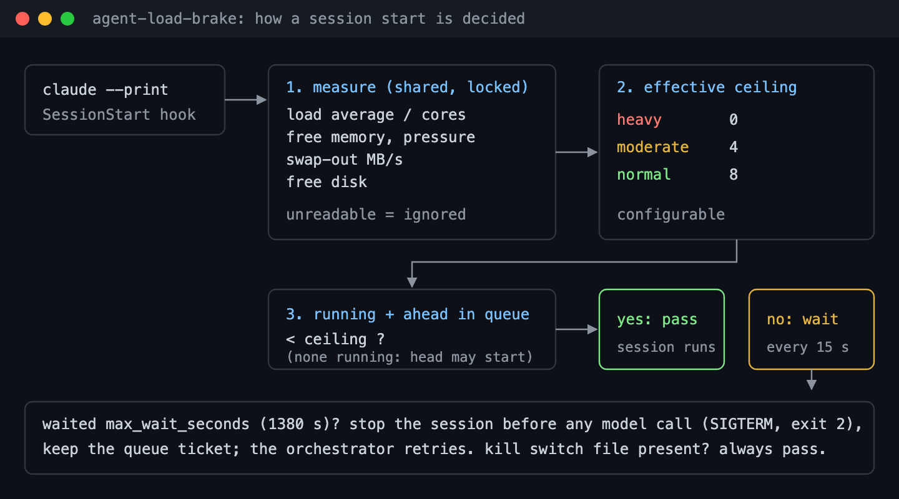

# agent-load-brake

[](https://www.npmjs.com/package/agent-load-brake) [](https://github.com/iosayin/agent-load-brake/actions/workflows/test.yml) [](LICENSE)  

**Stop a fleet of Claude Code agents from freezing your machine.**

Run enough headless agents in parallel (`claude --print` from an orchestrator, a cron job or a script) and sooner or later they all start at once: load climbs past 50, memory runs out, the machine swaps itself to a halt and every agent times out together. You come back to a frozen box and a pile of failed runs.

`agent-load-brake` is a Claude Code **SessionStart hook**. Before a headless session makes its first model call, the hook checks the machine and, if there is no room, **queues the session** until there is. First come, first served. Your own interactive sessions are never touched.

<p align="center"></p>

- 🧯 **Queues instead of piling on.** A dynamic ceiling on concurrent headless sessions: 8 normally, 4 under moderate load, 0 when the machine is heavy.
- 🚦 **Never "gives up and lets it through".** A long wait does not open the gate. After the maximum wait the session is stopped *before any model call* so your orchestrator can retry it later, and it keeps its place in the queue.
- 📦 **Zero dependencies.** A single Python 3.8+ script (standard library only) and a tiny Node.js installer. macOS and Linux.

## Install

```bash
npx agent-load-brake install --dry-run   # show what would change, write nothing
npx agent-load-brake install             # copy the hook, register it in ~/.claude/settings.json
npx agent-load-brake status              # current load, memory, swap, disk and the decision
```

```text
agent-load-brake: ok
  load=3.1 mem_free=41% pressure=1 swap_out=0.0MB/s disk_free=212GB swap_free=1481MB ceiling=8
  cores=10 agents=2 running=2 queued=0
  log=~/.local/state/agent-load-brake/brake.log kill_switch=~/.config/agent-load-brake/disabled
```

Remove it with `npx agent-load-brake uninstall`. If you have not edited the settings file since, it comes back **byte for byte**; otherwise only the hook entry is removed and your changes are kept.

Options: `--settings <file>` edits another settings file (for example a project's `.claude/settings.json`), `--python <path>` picks the interpreter. `CLAUDE_CONFIG_DIR` is respected.

## How it works

<p align="center"></p>

Every new headless session runs the hook. Under a file lock it measures the machine (the measurement is shared for a few seconds, so all waiters see the same state), counts the agent sessions that are already running, and decides:

| Signal | Heavy (ceiling 0) | Moderate (ceiling 4) | Source on macOS | Source on Linux |
|---|---|---|---|---|
| **Load average** (1 min) | > 2.0 × cores | > 1.5 × cores | `getloadavg` | `getloadavg` |
| **Free memory** | < 15 % | < 25 % | `kern.memorystatus_level` | `MemAvailable / MemTotal` |
| **Memory pressure** | critical | — | `kern.memorystatus_vm_pressure_level` ≥ 4 | PSI `full avg10` ≥ 10 % |
| **Swap-out rate** | > 16 MB/s | > 4 MB/s | `vm_stat` Swapouts, sampled over 3 s | `/proc/vmstat` `pswpout` |
| **Free disk** | < 15 GB | — | `/System/Volumes/Data` | `/` |

- **Dynamic ceiling.** Normally 8 headless sessions may run at once. Any moderate signal lowers that to 4. Any heavy signal lowers it to 0: nobody new starts. One exception, the **starvation guard**: if no agent is running at all, the head of the queue may start, so the machine is never left idle by its own brake.
- **FIFO queue.** Free slots go to the oldest waiters. A late arrival cannot measure a quiet moment and jump ahead.
- **Persistent tickets.** If your orchestrator passes stable task/agent ids in the environment (see `ticket_env`), a session that is stopped after the maximum wait keeps its queue position: when the task is retried, it re-enters at its old place.
- **Maximum wait.** Claude Code kills a hook that exceeds its timeout and *starts the session anyway*, so the hook decides first: after `max_wait_seconds` (1380 s; the installer registers the hook with a 1500 s timeout) it sends `SIGTERM` to its `claude` process and exits 2. No model call is made, the orchestrator sees a failed run and can retry.
- **Kill switch.** `touch ~/.config/agent-load-brake/disabled` turns the brake off instantly without touching any settings; `rm` it to turn it back on. Useful from an SSH session when you need every agent to start right now.
- **Fail open.** A metric that cannot be read never triggers the brake, and any error in the hook lets the session through. The brake must never be the thing that breaks your fleet.

What counts as an agent session: a process whose command line has a `claude` executable followed by `--print` or `-p`. Interactive sessions (the terminal UI, the desktop app, IDE extensions) do not match: they are never counted and never delayed. Set `match` to also require a substring (for example your orchestrator's working directory) when other headless jobs share the machine.

Every decision that involves waiting goes to the log:

```text
2026-11-02 03:12:07 waiting (heavy running=2/0 queued=0) agents=3 load=21.4 mem_free=38% pressure=1 swap_out=0.0MB/s disk_free=212GB swap_free=1481MB ceiling=0 heavy=load pid=48211
2026-11-02 03:13:52 passed after 105s running=3/4 queued=1 agents=4 load=14.2 mem_free=40% pressure=1 swap_out=0.0MB/s disk_free=212GB swap_free=1481MB ceiling=4 pid=48211
```

## Configuration

Every setting can be set as an environment variable `AGENT_LOAD_BRAKE_<NAME>` (upper case) or as a key in `~/.config/agent-load-brake/config.json` (lower case; see [`examples/config.json`](examples/config.json)). The environment wins over the file. Hooks inherit the environment of the `claude` process, so an orchestrator can also set them per run.

| Key | Default | Meaning |
|---|---|---|
| `max_agents` | `8` | Ceiling on concurrent headless sessions when the machine is fine |
| `mid_max_agents` | `4` | Ceiling under moderate load |
| `heavy_load_per_core` | `2.0` | 1-min load above this × cores is heavy |
| `mid_load_per_core` | `1.5` | 1-min load above this × cores is moderate |
| `min_free_mem_pct` | `15` | Free memory below this percentage is heavy |
| `mid_free_mem_pct` | `25` | Free memory below this percentage is moderate |
| `psi_critical` | `10` | Linux: PSI memory `full avg10` at or above this is critical pressure |
| `swap_out_mbps` | `16` | Swap-out above this many MB/s is heavy |
| `mid_swap_out_mbps` | `4` | Swap-out above this many MB/s is moderate |
| `min_free_disk_gb` | `15` | Free space on `disk_path` below this many GB is heavy |
| `disk_path` | `/System/Volumes/Data` on macOS, `/` elsewhere | Volume to watch |
| `max_wait_seconds` | `1380` | Maximum wait before the session is stopped (keep it below the hook timeout, 1500) |
| `poll_seconds` | `15` | Re-check interval while waiting (±20 % jitter) |
| `sample_seconds` | `3` | Swap-out sampling window |
| `cache_seconds` | `10` | How long a shared measurement is reused |
| `ticket_env` | `PAPERCLIP_TASK_ID,PAPERCLIP_AGENT_ID` | Comma-separated environment variables that identify a retried task (all must be set) |
| `ticket_ttl_seconds` | `21600` | Tickets older than this are discarded |
| `match` | *(empty)* | Extra substring an agent command line must contain to be counted and queued |
| `state_dir` | `/tmp/agent-load-brake-<uid>` | Lock, shared measurement, queue markers, tickets |
| `log_file` | `~/.local/state/agent-load-brake/brake.log` | Log of waits, passes after a wait and stops |
| `kill_switch` | `~/.config/agent-load-brake/disabled` | If this file exists the hook always passes |

The config file path itself can be moved with `AGENT_LOAD_BRAKE_CONFIG`.

## macOS and Linux notes

- **macOS:** memory comes from `kern.memorystatus_level` (the same "memory available" figure Activity Monitor's pressure graph is built on) and pressure from `kern.memorystatus_vm_pressure_level` (1 normal, 2 warning, 4 critical; only critical brakes). Free swap is logged but not used: macOS grows swap files and rarely shrinks them, so "little free swap" is normal and says nothing about the current state. Disk is measured on the data volume.
- **Linux:** memory is `MemAvailable / MemTotal` from `/proc/meminfo`; pressure uses [PSI](https://docs.kernel.org/accounting/psi.html) (`/proc/pressure/memory`, kernel 4.20+). Without PSI the pressure signal is simply unreadable and ignored; the other signals still work. In a container, the values are those the container can see.
- Tools are called with absolute paths (`/usr/sbin/sysctl`, `/usr/bin/vm_stat`) because hooks may run with a minimal `PATH`.
- Windows is not supported.

## FAQ

**Will it slow down my own Claude Code sessions?** No. Only headless sessions (`--print` / `-p`) are counted and queued. Interactive sessions pass immediately and do not take a slot.

**What does my orchestrator see when a session is queued?** A session that is still starting. When the hook lets it through, it runs normally. If the wait reaches `max_wait_seconds`, the `claude` process is terminated and exits non-zero, the same as any failed run; retry it as you would retry a crash. With `ticket_env` set, the retry keeps its queue position.

**Why not just let a session through after a long wait?** Because that is exactly when the machine is in the worst shape. An earlier version did that, and one night a long-waiting batch was released at load 55 and froze the machine. Stopping the session costs nothing (no model call has been made); starting it can cost everything.

**Why is the default ceiling 8?** It is a safe start for a 10–12 core workstation running typical coding agents (each with its own language servers, test runners and browsers). Watch the log for a day and tune `max_agents` and `mid_max_agents` to your machine.

**The hook is waiting and I need everything to start now.** `touch ~/.config/agent-load-brake/disabled`. Waiting hooks pick it up on their next check and new sessions skip the brake. `rm` the file when you are done.

**Does it need root, a daemon or a service?** No. It runs only when a session starts, as your user, and keeps its state in a temporary directory.

**Does it send anything anywhere?** No. No network access, no telemetry. It reads local system counters and writes a local log.

## Contributing

Issues and pull requests are welcome; see [CONTRIBUTING.md](CONTRIBUTING.md). Run `npm run check` and `npm test` before pushing. `bash test/smoke-pack.sh` installs the packed tarball in a throwaway home directory and checks that uninstall restores the settings file.

Running agents through [Paperclip](https://github.com/paperclipai/paperclip)? [paperclip-watchdog](https://github.com/iosayin/paperclip-watchdog) un-sticks tasks that stopped for mechanical reasons, and works well with this brake (a session stopped after the maximum wait is retried by your orchestrator).

## License

MIT
